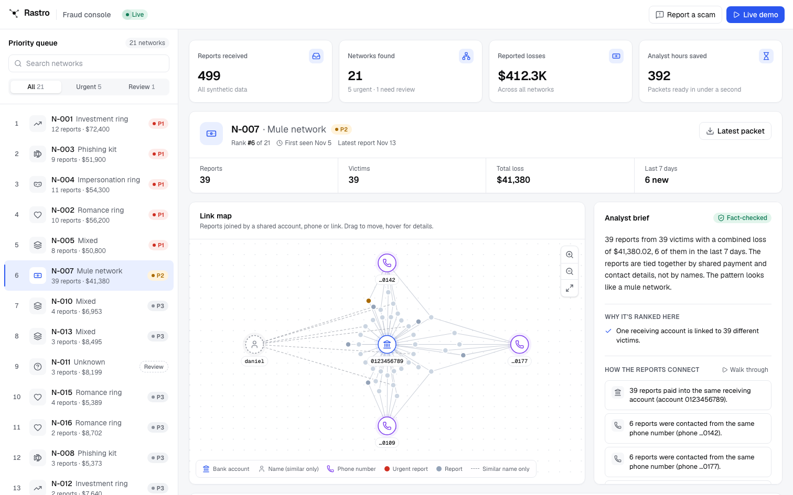
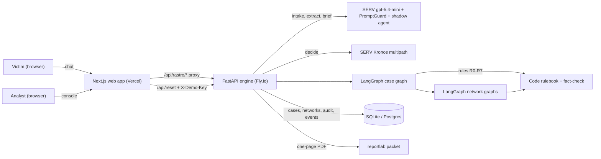
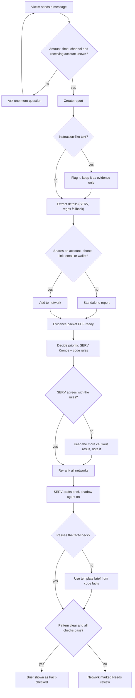

# Rastro

Scam report triage for bank fraud teams.

    

Rastro (Spanish for "trail") turns one scam victim's chat report into a bank-ready evidence packet in seconds. It then links the report to every earlier report that shares an account, phone or link, and ranks the networks behind them so a fraud team knows which one to act on first. The AI drafts and explains; written rules in code decide, and every AI claim is fact-checked before anyone reads it.

Built for the OpenServ SERV Hackathon, Edition 02 (Open Track). **All data is synthetic.** Rastro never freezes money, never blocks an account and never says anyone is guilty. It ranks, packages and explains. People act.

## Demo

- **Live site:** https://rastro.mrfomolabs.xyz
- **Analyst console with the live demo panel:** https://rastro.mrfomolabs.xyz/console?demo=1
- **Victim report chat:** https://rastro.mrfomolabs.xyz/report
- **Engine health:** https://rastro-engine.fly.dev/health

> 🎥 Demo video: _add link_



## Contents

- [Problem](#problem)
- [Solution](#solution)
- [How to test](#how-to-test)
- [Architecture](#architecture)
- [Flowchart](#flowchart)
- [Tech stack](#tech-stack)
- [Getting started](#getting-started)
- [Project structure](#project-structure)
- [Deployment](#deployment)
- [Usage / API](#usage--api)
- [How SERV is used](#how-serv-is-used)
- [Roadmap](#roadmap)
- [Contributing](#contributing)
- [License](#license)
- [Team / Acknowledgements](#team--acknowledgements)

## Problem

When someone is scammed, they report it to their bank as a story: a phone call, an amount, an account number, maybe a pasted message. A fraud analyst then has to turn that story into evidence the receiving bank can act on, and check by hand whether the same account or phone shows up in earlier reports.

- **Time is short.** A hold on the receiving account is only realistic within about 24 hours of the payment. Reports wait in a queue in the order they arrived, not in order of urgency.
- **Networks stay hidden.** One mule account can collect money from dozens of victims, but each report is read alone. Forty $1,000 reports look like forty small cases instead of one $40,000 network.
- **Manual work.** Rastro's own estimate is about 45 minutes to build one bank-ready packet by hand, and about 2 hours to map and write up one network.

## Solution

A victim answers a short chat. Rastro extracts the facts, builds a one-page PDF packet, and links the report to earlier ones that share a strong detail (an account, phone, website, email or wallet). It then re-ranks every network using a written rulebook, and gives analysts a short brief explaining why the reports are linked. SERV writes the chat and the brief and reads the rulebook; code computes every number and has the final say.

**Key features**

- **Chat intake.** One question at a time until the amount, time of payment, contact channel and receiving account are known. No form, no account.
- **Evidence packet in seconds.** A one-page PDF in plain language, ready before the ranking finishes.
- **Network linking.** Reports join only through shared accounts, phones, links, emails or wallets. Similar names show up as a weak hint and never join reports.
- **Priority queue.** Written rules (R0–R7) set each network's priority from code-computed facts. SERV (Kronos multipath) reads the same rules; when it disagrees, the more cautious result wins and the disagreement is shown.
- **Fact-checked briefs.** Every claim must point to real links in the graph, every number must match the data, and no names or accusations are allowed. A failed AI draft is replaced by a template brief built only from code facts.
- **Prompt-injection safe.** Text in a report that tries to instruct the system is flagged, kept as evidence and cannot change the ranking. A test proves it.
- **Full audit trail.** Every step records who did it (rules, SERV, shadow agent, or a person), the model, cost and time.

## How to test

No login, wallet or key is needed. The data is synthetic.

**Try this** on https://rastro.mrfomolabs.xyz/console?demo=1

1. Look at the **Priority queue**. Network **N-007** (Mule network, 39 reports) is at **#6**, priority P2.
2. In the **Live demo** panel, press **Play the demo**. It resets the data, then a scripted victim reports a $2,400 bank-impersonation scam paid 3 hours ago. You see the chat happen.
3. Within about 5 seconds of the chat ending, N-007 moves **from #6 to #1** and becomes **P1**. The **Why it's ranked here** list explains it, including a line if SERV suggested a different rating.
4. Within about 15–40 seconds, the **Analyst brief** updates and shows **Fact-checked**.
5. Open the **Reports** tab and download the PDF for the new report marked **New**.
6. Open the **Activity** tab to see each step and whether rules, SERV or the shadow agent did it.

Other things to check:

- **Injection attempt:** report `C-0450` contains text that tries to give the system orders. Find its network in the queue: the report is flagged and the network keeps its priority.
- **Names never merge networks:** reports `C-0300` and `C-0301` ("John Okafor" and "Jon Okafor") share only a similar name and stay separate.
- **Needs a person:** network **N-011** is held for review because its scam pattern is unclear.
- **File your own report:** https://rastro.mrfomolabs.xyz/report

Only one person should run the live demo at a time, because the demo data is shared.

**Automated tests**

```bash
cd engine
.venv/bin/python -m pytest -q
```

Passing looks like `28 passed`. The tests run offline: the SERV path is tested with a fake model, so they spend no credit.

## Architecture



- **Web app** (`web/`): landing page, victim chat and analyst console. The browser only talks to this app, which forwards `/api/rastro/*` to the engine, so there is no CORS setup. The demo reset key stays on the server.
- **Engine** (`engine/app/main.py`): FastAPI API. Intake runs synchronously; each finished report runs the case graph in a background thread.
- **LangGraph graphs** (`engine/graph/`): the case graph (guard, completeness, urgency, extract, link, structure, packet, networks) and the network graphs (decide, then brief and verify).
- **Code rulebook** (`engine/rules/`): urgency U1–U4, network rules R0–R7, the score formula, linking, normalising and the injection guard. These are the source of every number.
- **SERV** (`engine/app/serv.py`): every call has a time limit and a code fallback, and spending stops at `SERV_BUDGET_USD`.
- **Storage** (`engine/app/db.py`): contract-shaped JSON in SQLite locally or Postgres; the demo resets from `engine/data/prebaked.json`.

## Flowchart



## Tech stack

| Area | Tools |
|---|---|
| Frontend | Next.js 16, React 19, Tailwind CSS 4, Framer Motion, lucide-react |
| Backend | Python 3.12, FastAPI, Uvicorn, Pydantic 2, SQLAlchemy 2 |
| AI / Agent | OpenServ SERV via the `openai` SDK (`gpt-5.4-mini`, `-serv-multipath`, `-serv-kronos-multipath`, PromptGuard, shadow agent), LangGraph |
| Linking | networkx (connected components), RapidFuzz (name look-alikes) |
| Documents | reportlab (PDF packet) |
| Data | SQLite (default), Postgres supported |
| Infra | Fly.io (engine, Docker), Vercel (web) |
| Tooling | pytest, uv, TypeScript, ESLint |

## Getting started

### Prerequisites

- Python 3.12 and [uv](https://docs.astral.sh/uv/) (or plain `venv` + `pip`)
- Node.js 20.9 or newer, and npm
- Optional: an OpenServ SERV API key. Without one, the engine runs fully offline on its code fallbacks.

### Installation

```bash
git clone https://github.com/mrfomoweb3/Rastro.git
cd Rastro
cp .env.example .env          # then edit .env

cd engine
uv venv .venv --python 3.12
uv pip install --python .venv/bin/python -r requirements.txt

cd ../web
npm install
```

### Environment variables

Engine (`.env` at the repo root, or Fly secrets):

| Variable | What it is for | Required |
|---|---|---|
| `SERV_API_KEY` | OpenServ SERV key. Empty means offline mode (code fallbacks). | No |
| `DEMO_KEY` | Key for `POST /demo/reset`. Change it from the default. | Yes, for reset |
| `DATABASE_URL` | `sqlite:///rastro.db` by default; a Postgres URL also works. | No |
| `SERV_BUDGET_USD` | SERV spending cap per server start, default `5`. | No |
| `SERV_MODEL_BASE` | Base model, default `gpt-5.4-mini`. | No |
| `USE_KRONOS` | `true` to try Kronos multipath first in `decide`. | No |
| `SERV_BASE_URL` | Default `https://inference-api.openserv.ai/v1`. | No |
| `PRICE_IN_PER_M`, `PRICE_OUT_PER_M` | USD per 1M tokens for cost tracking. Placeholders are used when empty. | No |
| `ALLOWED_ORIGINS` | CORS origins, only needed if a browser calls the engine directly. | No |
| `RASTRO_OFFLINE` | `1` forces offline mode even with a key (tests use this). | No |

Web (`web/.env.local`, or Vercel environment variables):

| Variable | What it is for | Required |
|---|---|---|
| `RASTRO_API_URL` | Engine address, default `http://localhost:8000`. Read at build time. | Yes, in production |
| `DEMO_KEY` | Same value as the engine's. Used only on the server for `/api/reset`. | Yes, for reset |

### Run locally

Terminal 1, the engine:

```bash
cd engine
.venv/bin/uvicorn app.main:app --reload --port 8000
```

On first start with an empty database it loads `engine/data/prebaked.json` (499 synthetic reports, 21 networks).

Terminal 2, the web app:

```bash
cd web
npm run dev
```

Open http://localhost:3000, or http://localhost:3000/console?demo=1 for the console with the demo panel.

To rebuild the demo data from scratch:

```bash
cd engine
.venv/bin/python -m scripts.gen_seed   # 499 synthetic cases -> data/seed_cases.json
.venv/bin/python -m scripts.prebake    # full pipeline over the seed -> data/prebaked.json
```

## Project structure

```text
Rastro/
├── contract/            Shared contract: schema.py (Pydantic), schema.ts, JSON examples, CHANGELOG
├── demo/
│   └── hero_cases.json  Hero seed stories and the scripted live report
├── engine/
│   ├── app/             FastAPI app, DB layer, SERV client, intake chat, PDF, pipeline steps (core.py)
│   ├── graph/           LangGraph case graph and network graphs
│   ├── rules/           rulebook.md (SERV system prompt), urgency, R0–R7 + score, linking, injection guard
│   ├── scripts/         gen_seed, prebake, cost_probe, export_examples, refresh_wording
│   ├── data/            seed_cases.json and prebaked.json (the demo snapshot)
│   └── tests/           28 tests: rules, the live demo end to end, the SERV path
├── web/
│   └── src/             Next.js app: landing (/), report chat (/report), console (/console)
├── docs/                Screenshots
├── Dockerfile           Engine image (built from the repo root)
└── fly.toml             Fly.io config for the engine
```

## Deployment

| Part | Where | Address |
|---|---|---|
| Web app | Vercel, project root `web/`, deploys on every push to `main` | https://rastro.mrfomolabs.xyz |
| Engine | Fly.io app `rastro-engine`, region `lhr`, one machine | https://rastro-engine.fly.dev |

Engine, from the repo root:

```bash
fly secrets set SERV_API_KEY=your-key DEMO_KEY=your-demo-key -a rastro-engine
fly deploy --ha=false
```

Keep exactly **one** machine: the demo data lives in that machine's SQLite file, and two machines would each have their own copy.

Web: set `RASTRO_API_URL=https://rastro-engine.fly.dev` and the same `DEMO_KEY` in the Vercel project, then redeploy. The engine address is read at build time.

## Usage / API

All endpoints return contract JSON (`contract/schema.py`). Through the web app they live under `/api/rastro/`.

| Method | Path | What it does |
|---|---|---|
| GET | `/health` | Engine status, whether SERV is on, spend so far |
| POST | `/intake/sessions` | Start a victim chat |
| POST | `/intake/sessions/{sid}/messages` | Send one message `{ "text": "..." }` |
| GET | `/cases`, `/cases/{id}` | Reports |
| GET | `/cases/{id}/packet.pdf` | The evidence packet |
| GET | `/networks`, `/networks/{id}` | Networks, ranked |
| POST | `/networks/{id}/brief` | Write a brief on demand |
| GET | `/audit?object_id=...` | Audit trail for a report or network |
| GET | `/stats` | Totals, cost, analyst hours saved |
| GET | `/events?after=...` | Live events (case created, linked, re-ranked, brief updated) |
| POST | `/demo/reset` | Restore the demo data; needs the `X-Demo-Key` header |

Example: start a chat and send one message.

```bash
curl -s -X POST https://rastro-engine.fly.dev/intake/sessions
curl -s -X POST https://rastro-engine.fly.dev/intake/sessions/S-xxxxxxxxxxxx/messages \
  -H "content-type: application/json" -d '{"text": "I sent $2,400 about 3 hours ago."}'
```

## How SERV is used

| SERV feature | Where | File |
|---|---|---|
| `gpt-5.4-mini` | Intake chat, detail extraction, brief | `engine/app/intake.py`, `engine/graph/case_graph.py`, `engine/app/core.py` |
| Kronos multipath (`-serv-kronos-multipath`) | `decide`: reads the rulebook and rates each network | `engine/app/core.py` (`decide`) |
| Multipath (`-serv-multipath`) | `decide` fallback if Kronos does not answer in time | `engine/app/core.py` (`decide`) |
| PromptGuard (`serv_prompt_guard`) | Every SERV call | `engine/app/serv.py` |
| Shadow agent (`serv_shadow_agent`, with a hint) | Brief: validate-and-retry loop | `engine/app/core.py` (`brief`) |

How code keeps the AI honest:

1. **Numbers come from code.** Metrics, urgency and score are computed in Python. The fact-check rejects any number in a brief that does not match.
2. **No invented links.** Every claim in a brief must point to links that exist in the graph.
3. **Names never merge networks.** Networks are connected components over strong links only.
4. **The cautious result wins (R7).** When SERV and the rules disagree on priority, the more urgent result is kept and the reason is shown. SERV cannot overrule a rule the facts already prove (for example R2: one account shared by 3+ victims is a mule network).
5. **Victim text is data.** It is sent inside `<evidence>` tags, flagged if it tries to instruct the system, and can only add details that literally appear in it.
6. **Fallbacks are labelled.** Without SERV, the audit log records `actor: "code"` and `model: "offline-fallback"`, so a fallback is never shown as an AI step.

**Cost and speed, measured on the live deployment (15 Nov 2026):** about **$0.003 of SERV per live report** (9 calls) at the placeholder prices in `engine/app/pricing.py`. After the victim's last message: packet ready in 2–7 s, queue re-ranked in 4–14 s, brief ready in 15–40 s. Every SERV call has a 12–45 s time limit.

## Known limits

- Reports are not verified, and every report counts as a new victim, so one person filing many reports could push an account up the queue. A real deployment needs identity checks on intake.
- The console has no login. It is a demo on synthetic data.
- The demo data is shared: anyone can press reset, and two people running the live demo at once will see each other's report.
- Prices in `engine/app/pricing.py` are placeholders until checked against the SERV catalog.

## Roadmap

- [x] Chat intake with PromptGuard and code-checked fields
- [x] Network linking on strong details only, with name look-alikes as weak hints
- [x] Rulebook priority with SERV Kronos and R7 reconciliation
- [x] Fact-checked briefs with a template fallback
- [x] One-page PDF evidence packet
- [x] Analyst console with link map, brief and audit trail
- [x] Live deployment on Fly.io and Vercel with a SERV spending cap
- [ ] Real SERV prices in the cost table
- [ ] Analyst login and per-team data
- [ ] Victim identity checks so one person cannot inflate a network
- [ ] Analyst feedback on briefs and rankings, stored in the audit trail
- [ ] Export to bank case-management systems

## Contributing

1. Fork the repo and create a branch: `git checkout -b my-change`.
2. Keep `contract/schema.py` and `contract/schema.ts` in step, and log any contract change in `contract/CHANGELOG.md`.
3. Run the engine tests (`cd engine && .venv/bin/python -m pytest -q`) and the web type check (`cd web && npx tsc --noEmit`). Both must pass.
4. Open a pull request that says what changed and why.

Rules: numbers shown to users must come from code, never from a model. Any new SERV call needs a time limit and a code fallback. Keep all data synthetic.

## License

_Add a license_

## Team / Acknowledgements

- [mrfomoweb3](https://github.com/mrfomoweb3): _add role_
- _add teammate name and link_: _add role_
- Built for the **OpenServ SERV Hackathon, Edition 02**, on [SERV Reasoning](https://docs.openserv.ai).
- Libraries: FastAPI, LangGraph, networkx, RapidFuzz, reportlab, Next.js, Tailwind CSS, Framer Motion, lucide-react. UI pieces adapted from [EasyUI](https://easyui.site).
